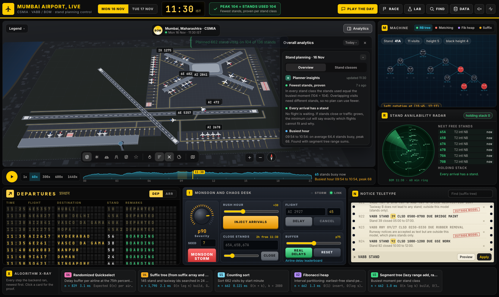
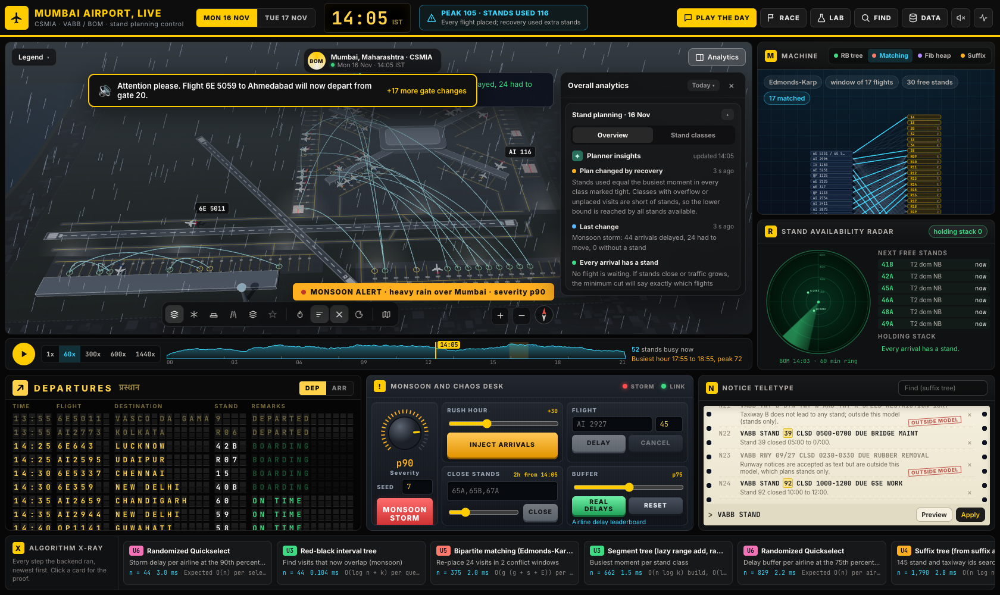
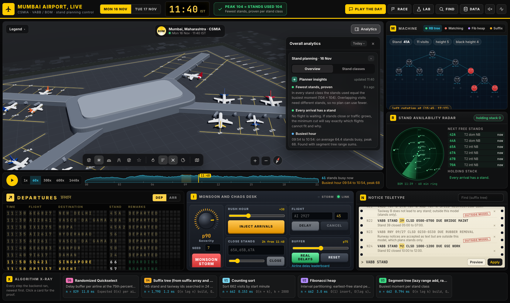
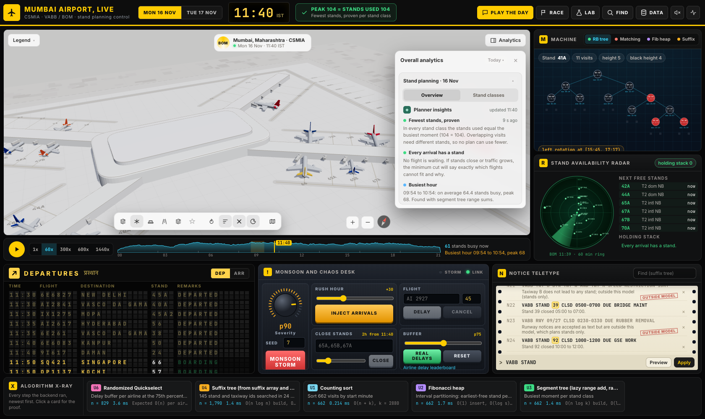
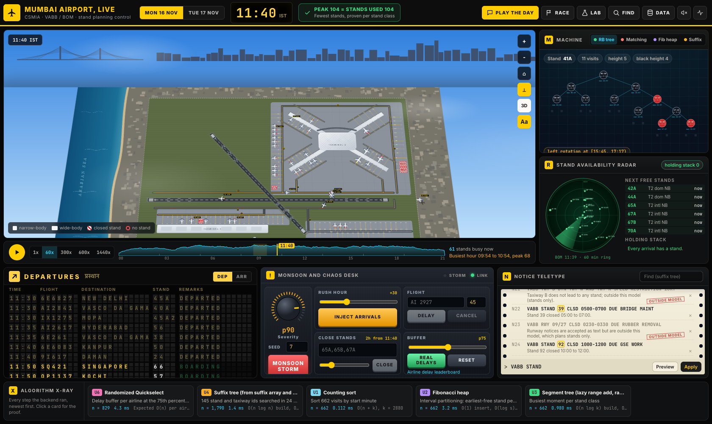
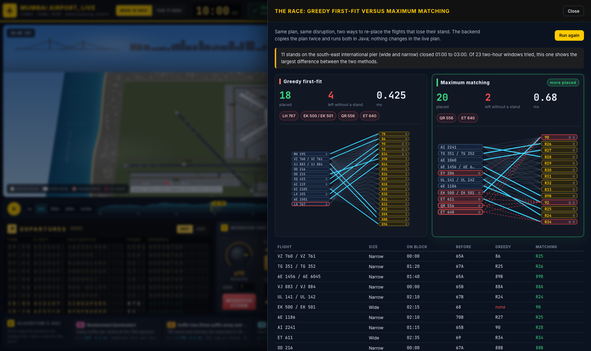
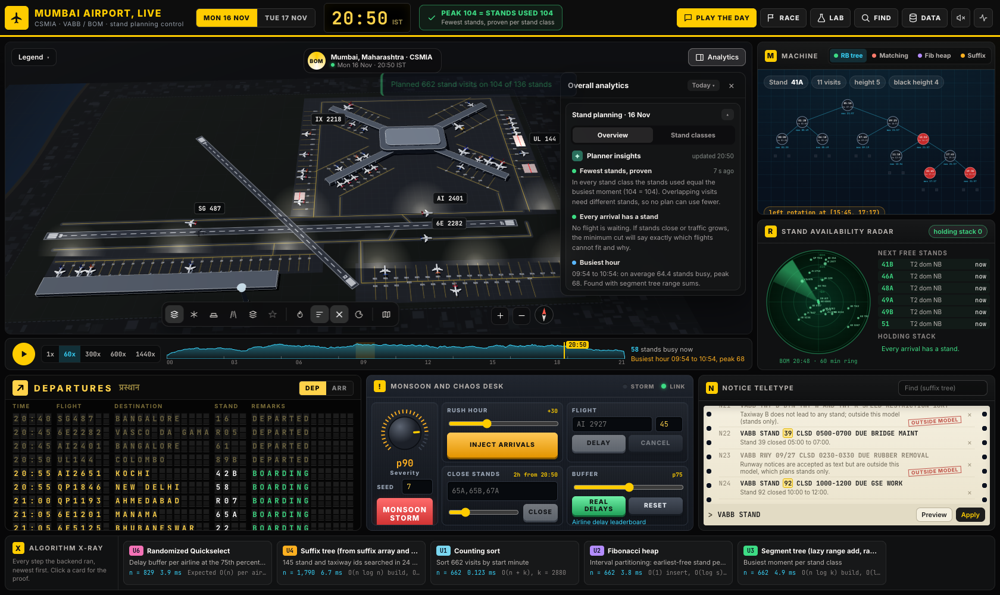
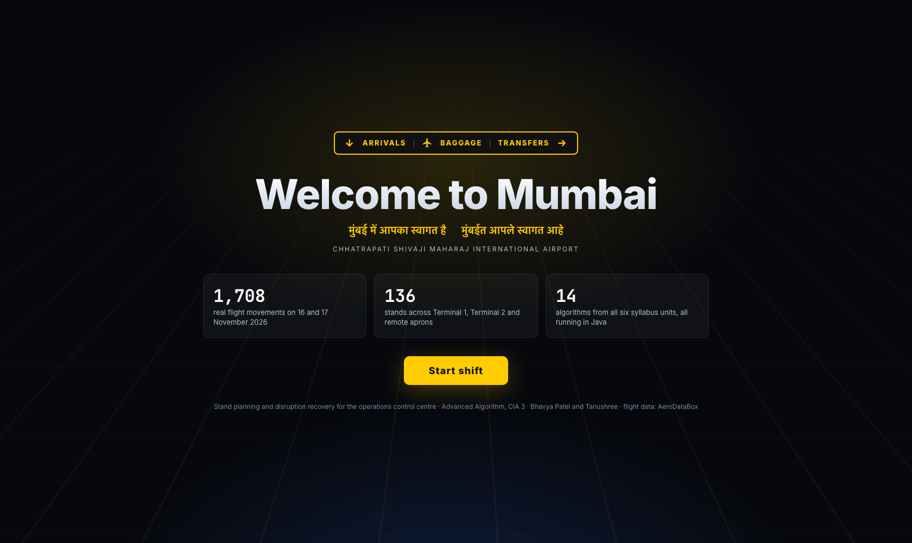

# Mumbai Airport, Live: Gate Planner

A live, animated stand (gate) planner for Chhatrapati Shivaji Maharaj International Airport, Mumbai
(ICAO VABB, IATA BOM), built on two real days of flights (16 and 17 November 2026).

It gives every flight a compatible stand on the fewest stands possible and proves it, adds safety
buffers from each airline's real delays, recovers in milliseconds when flights are delayed or
cancelled, a monsoon hits, or an airport notice closes stands, and explains every decision,
including exactly why a flight cannot be placed when that happens.

All planning runs in Java (Spring Boot). The React frontend only collects input and draws what the
backend returns.

Advanced Algorithm, Continuous Internal Assessment 3, Semester V, B.Tech CS AI and ML,
ATLAS SkillTech University. Team: Bhavya Patel and Tanushree.



## What it does

| Feature | What you see | Algorithm (unit) |
|---|---|---|
| 3D digital twin | A Three.js model of the airport built from the stand layout: terminals, jet bridges and aircraft that land, taxi, park and take off; cinematic camera moves, a clay model view, an analytics panel and a 2D map fallback | Display only; every position follows the stand and times from Java |
| Live Mumbai Day | Real flights land, taxi, park, push back and take off on a replay clock (1x to 1440x) | Counting sort (U1), segment tree (U3) |
| Smart Stand Assignment | Every flight on a compatible stand, fewest stands per class, with a proof badge | Interval partitioning on a Fibonacci heap (U2), segment tree lower bound (U3) |
| Delay Shield | Delay or cancel any flight; clashes found instantly and re-planned | Red-black interval tree (U3), bipartite matching (U5) |
| Unplaced flights | Every flight without a stand gets a plain-English reason | Minimum cut, Hall's theorem (U5) |
| Stand Availability Radar | Next free stand per class, holding stack, decrease-key pulses | Fibonacci heap (U2) |
| Notice Command Centre | Type or withdraw airport notices; preview the impact first | Suffix tree from suffix array and LCP (U4), KMP baseline |
| Monsoon and Chaos Desk | Storm, rush hour, close stands, delay, cancel, replay real delays | Randomized Quickselect (U6, CO5), median-of-medians (U1) |
| Flight finder | Autocomplete by flight, airline, city or registration | Trie (U4) |
| The Race | Greedy first-fit against maximum matching on the same disruption | Edmonds-Karp (U5) |
| Proof and Benchmark Lab | Every algorithm against its baseline at three sizes; exact versus smart | All, plus the NP-hardness study (U6) |
| Machine view and X-ray | The data structure behind each move, animated from backend snapshots | All |

## Quick start

Prerequisites: Java 17, Node.js 26 (npm 11). Maven is not needed; the wrapper downloads it.

```bash
# 1. backend (http://localhost:8080)
cd backend
./mvnw spring-boot:run

# 2. frontend (http://localhost:5173), in a second terminal
cd frontend
npm install
npm run dev
```

Open http://localhost:5173 and press **Start shift**. The demo runs entirely from the saved CSV
files; no internet connection is needed.

Useful URL options: `?start=1` skips the welcome screen, `?t=840` sets the clock (minutes after
midnight), `?day=2` opens 17 November.

### Run the tests and benchmarks

```bash
cd backend
./mvnw test                                   # 121 JUnit tests
./mvnw -q compile exec:java -Dexec.mainClass=com.gateplanner.bench.BenchmarkRunner -Dexec.args="../docs/benchmarks"
```

### Fetching fresh flight data (optional)

The saved data already covers both days. To fetch it again you need a free AeroDataBox key from
RapidAPI, set as an environment variable (never commit it):

```bash
export AERODATABOX_KEY="your-key"
cd backend
./mvnw -q compile exec:java -Dexec.mainClass=com.gateplanner.data.FlightFetcher -Dexec.args="fetch ../data 2026-11-16"
```

`convert` instead of `fetch` rebuilds the CSV files from the saved raw JSON in `data/raw/`.

## Data

| Data | Source | Real or assumed |
|---|---|---|
| Flights: 837 movements on 16 Nov, 871 on 17 Nov | AeroDataBox airport arrivals and departures for VABB (RapidAPI) | Real |
| Delays | Actual (revised) time minus scheduled time, same data | Real |
| Stands (136) | 71 ids observed as gates in the flight data; the rest complete the layout. Each row says `observed` or `assumed` | Partly assumed |
| Notices (24) | Written in the official format, for example `VABB STAND 45A2 CLSD 0100-0500` | Sample content |
| Rush hour arrivals | Generated from the real airline and size mix with a seed, labelled `RUSH` | Simulated |

Flight data attribution: AeroDataBox (https://aerodatabox.com) via RapidAPI. More detail on the
stand list, notices and delay statistics is in [docs/benchmarks/README.md](docs/benchmarks/README.md).

### Assumptions

- An arrival and a departure with the same aircraft registration, 25 minutes to 10 hours apart at
  the same terminal, form one stand visit (on block to off block). Otherwise a standard turnaround
  is used: 45 minutes narrow-body, 90 minutes wide-body.
- Wide-body aircraft (A330, A340, A350, A380, B777, B787, B747) need wide stands. International
  flights need international stands and domestic flights domestic stands; each flight stays at its
  own terminal.
- Each visit is followed by a buffer equal to the airline's real departure delay at the chosen
  percentile, capped at 60 minutes. The default is the 75th percentile: departure times in the
  data are close to take-off, so they include taxi-out, and at the 90th percentile every airline
  already exceeds the cap. The slider offers 50 to 99.
- The plan is built on scheduled times; **Real delays** replays the actual times and recovers.

## How the planner works

1. **Sort.** Counting sort orders the stand visits by start minute in O(n + k).
2. **Assign.** For each stand class (terminal, international or domestic, size) the stands in use
   sit in a Fibonacci heap keyed by the minute they become free. A visit takes the stand that frees
   earliest if it is free in time, otherwise the class opens a new stand (jet bridge stands first).
   Visits whose class is full go to a holding stack and are then placed by maximum matching on any
   compatible stand with a gap.
3. **Record.** Each placement goes into that stand's red-black interval tree and the occupancy
   segment tree.
4. **Prove.** Inside one class all stands are interchangeable and interval partitioning opens a new
   stand only when all open stands are busy, so stands used equals the busiest moment, which the
   segment tree measures. No plan can do better, because overlapping visits need different stands.
5. **Recover.** After a delay, cancellation, storm or closure, the interval trees find every visit
   that now overlaps another (the one that starts later moves). The moved visits are cut into
   conflict windows; in each window a bipartite graph of visits and free compatible stands is
   solved by Edmonds-Karp. When visits stay unmatched, the minimum cut gives a set S of visits whose
   usable stands N(S) are fewer than |S|: a proof by Hall's theorem, turned into a sentence.
6. **Notices.** On each replan the suffix tree over all notice text is searched for every stand id
   and taxiway id.

**Honest limitation.** Matching is optimal inside each conflict window; across windows, and with
preferences such as walking distance or airline piers, full gate assignment is NP-hard. The Lab
compares our method with an exact branch and bound on small inputs.

## Algorithms

| Class | Unit | Time | Space | Baseline |
|---|---|---|---|---|
| `algo/sort/CountingSort` | 1 | O(n + k) | O(n + k) | `MergeSort`, O(n log n) |
| `algo/select/MedianOfMedians` | 1 | O(n) worst case | O(n) | Randomized Quickselect |
| `algo/heap/FibonacciHeap` | 2 | O(1) insert and decrease-key, O(log n) extract-min (amortised) | O(n) | `BinaryHeap` |
| `algo/interval/RedBlackIntervalTree` | 3 | O(log n) insert and delete, O(log n + k) overlaps | O(n) | Linear scan |
| `algo/segtree/LazySegmentTree` | 3 | O(log n) range add, max, sum | O(n) | Recount per minute |
| `algo/trie/Trie` | 4 | O(m) per prefix | O(total key length) | Linear scan |
| `algo/text/SuffixTree` (from `SuffixArray`, `LcpArray`) | 4 | O(n log n) build, O(m + occ) search | O(n) | `KmpMatcher`, O(n + m) per search |
| `algo/matching/BipartiteMatcher`, `MaxFlowNetwork`, `MinCutExplainer` | 5 | O(min(L, R)(V + E)) | O(V + E) | `GreedyFirstFit` |
| `algo/select/RandomizedQuickselect` | 6 | Expected O(n) | O(n) | Full sort |
| `algo/exact/ExactGateSolver` | 6 | Exponential (branch and bound) | O(n + m) | Brute force, our heuristic |

Every assessed algorithm is our own Java code; Java collections are used only as plain containers.
Every random process takes a seed.

## API examples

```bash
# build a plan for 16 November with buffers at the 75th percentile
curl -X POST localhost:8080/api/plan -H 'Content-Type: application/json' -d '{"day":1,"bufferPercentile":75}'

# delay a flight by 45 minutes at 10:00 and recover
curl -X POST localhost:8080/api/plan/{id}/delay -H 'Content-Type: application/json' \
  -d '{"flight":"AI 2927","minutes":45,"atMinute":600}'

# why is this flight on its stand?
curl localhost:8080/api/plan/{id}/why/AI2927

# close stands with a notice (mode: preview or apply)
curl -X POST localhost:8080/api/plan/{id}/notices -H 'Content-Type: application/json' \
  -d '{"text":"VABB STANDS 65A,65B CLSD 1400-1800","mode":"apply"}'

# monsoon storm at the 95th percentile, seed 7, 14:00 to 17:00
curl -X POST localhost:8080/api/plan/{id}/storm -H 'Content-Type: application/json' \
  -d '{"severityPercentile":95,"seed":7,"from":840,"to":1020}'

# greedy versus matching
curl -X POST localhost:8080/api/plan/{id}/race

# trie autocomplete and suffix tree notice search
curl 'localhost:8080/api/flights/search?q=AI2&day=1'
curl 'localhost:8080/api/notices/search?q=STAND%2064'
```

| Method and path | Purpose |
|---|---|
| `GET /api/flights?day=1`, `GET /api/flights/search?q=` | Flights for a day, trie autocomplete |
| `POST /api/plan`, `GET /api/plan/{id}` | Build or read a plan (assignments, certificate, trace, snapshots) |
| `GET /api/plan/{id}/occupancy`, `/busiest?window=60` | Busy stands per minute, busiest window |
| `POST /api/plan/{id}/delay`, `/cancel`, `/real-times` | Disruptions and real replay |
| `GET /api/plan/{id}/why/{flight}`, `POST /api/plan/{id}/race` | Explanation, greedy versus matching |
| `POST /api/plan/{id}/notices`, `DELETE /api/plan/{id}/notices/{nid}` | Validate, preview, apply or withdraw a notice |
| `POST /api/plan/{id}/storm`, `/rush` | Monsoon storm, rush hour |
| `GET /api/plan/{id}/radar`, `/board` | Availability radar, departures board |
| `GET /api/stats/delays`, `GET /api/snapshots/{structure}` | Delay leaderboard, machine view snapshots |
| `POST /api/bench/run`, `POST /api/exact` | Benchmarks, exact versus smart |

Errors use `{error, message, details}`: 400 for invalid input (for example a negative delay or
`Stand 999 not found`), 404 for an unknown plan or flight, 422 for valid but impossible requests
(for example the exact solver on more than 18 flights).

## Project layout

```
backend/   Spring Boot app: model, data import, algo (all assessed algorithms), engine, api, bench
frontend/  React + Vite: scene3d (Three.js airport), scene (2D map), hud, machine views, panels
data/      flights_day1.csv, flights_day2.csv, stands.csv, notices.txt, delay_stats.csv, raw/
docs/      benchmarks (CSV and notes), screenshots
```

## Screenshots

| Monsoon storm: reassignment arcs | Terminal 2 close up |
|---|---|
|  |  |

| Clay model view | 2D map |
|---|---|
|  |  |

| The race: greedy versus matching | Night operations |
|---|---|
|  |  |



## Contributions

Bhavya Patel: data import and flight fetching, domain model, counting sort, segment tree,
red-black interval tree, bipartite matching and min-cut, trie, the planner and recovery engine,
flight and plan endpoints, the airport scene, HUD, story mode, race and the red-black tree and
matching views.

Tanushree: Fibonacci and binary heaps, suffix array, LCP, suffix tree and KMP, randomized
Quickselect and median-of-medians, the exact solver and NP-hardness study, availability radar,
notices, storms and rush hour, statistics and benchmarks, the departures board, announcements,
chaos desk, notice teletype, leaderboard, benchmark lab and the Fibonacci heap and suffix tree views.

Tanushree's laptop stopped working during the project. With faculty approval, her part was
developed on Bhavya's machine and pushed from her own account.
